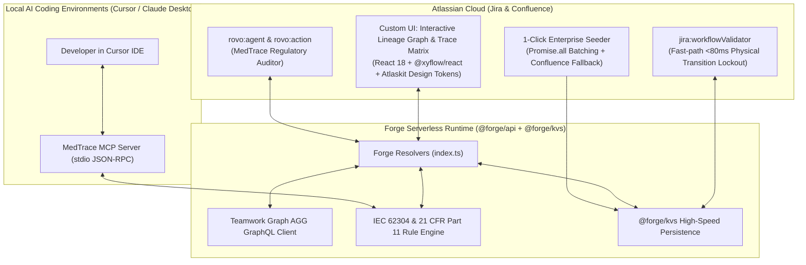

# MedTrace — IEC 62304 & FDA 21 CFR Part 11 Living Traceability Engine

> **Built for Atlassian Codegeist 2026**  
> **Track:** Apps for Specialized Industries (Medical Devices & Healthcare)  
> **Target Bonuses:** Best Agents (Rovo) • Best App with Atlassian MCP • Best Teamwork Graph (TWG) Integration • Best Marketplace App  

---

## 1. Executive Summary

In life-critical medical device software (e.g. smart infusion pumps, pacemakers, surgical robotics), regulatory bodies (FDA 21 CFR Part 11, EU MDR, and IEC 62304) legally mandate a **continuous, unbroken bidirectional software traceability matrix**:

$$\text{ISO 14971 Clinical Hazard} \longleftrightarrow \text{Safety Requirement (Confluence)} \longleftrightarrow \text{Firmware Task (Jira)} \longleftrightarrow \text{Pull Request} \longleftrightarrow \text{Verification Test (HIL/Unit)} \longleftrightarrow \text{Part 11 Electronic Signature}$$

If a single requirement changes or code ships without an attached verification test, the FDA rejects the 510(k) submission or issues formal warning letters. Today, medical device manufacturers spend \$100k+/year on disconnected legacy systems (Jama, Polarion) and maintain brittle spreadsheets.

**MedTrace** turns Atlassian Cloud into an automated, regulatory-grade enforcement platform:
1. **Interactive Visual Lineage Graph:** A React Flow (`@xyflow/react`) canvas rendering the 5-stage regulatory chain with animated status edges and pulsating alerts for unverified Class C risks.
2. **Teamwork Graph (TWG) Traversal:** Connects Jira issues, Confluence specifications, and remote repository links through the Atlassian GraphQL Gateway.
3. **Physical Jira Release Gate (`jira:workflowValidator`):** Physically blocks Jira issues or releases from transitioning to "Done" if an ISO 14971 Class C hazard lacks test verification or has signature drift.
4. **FDA 21 CFR Part 11 Cryptographic Audit Trail:** Tracks SHA-256 hashes of Confluence specifications. If an engineer modifies an approved spec (e.g. max bolus rate changed from 5.0 to 5.5 mL/hr), MedTrace instantly invalidates the signature and locks the release.
5. **Rovo Assignable Agent (`rovo:agent`):** The "MedTrace Auditor" AI compliance officer, capable of auditing sprints, analyzing hazard blast radius, and guiding remediation.
6. **Model Context Protocol (`rovo:mcp` + Local IDE Server):** Exposes Forge tools to Cursor, Claude Desktop, and AI coding environments, allowing developers to query regulatory risks right from their IDE before pushing code.
7. **1-Click Enterprise Demo Seeder:** A 1-click provisioning button that seeds a full Smart Infusion Pump Firmware v2.1 dataset with realistic hazards, Confluence SRS requirements, and tests in under 4 seconds.

---

## 2. Architecture & Modules



---

## 3. Quick Start & Testing Instructions for Judges

### Live Demo Site
* **Site URL:** `https://one-atlas-feur.atlassian.net`
* **App Location:** 
  * In Jira: Open any project $\rightarrow$ Click **MedTrace IEC 62304** in the project sidebar.
  * In Jira Issue View: Open any issue $\rightarrow$ Click the **MedTrace Regulatory & Safety** issue panel.

### Testing the 1-Click Seeder
1. Open the **MedTrace IEC 62304** project page.
2. In the top right header, click **`[⚡ Seed Demo Suite]`**.
3. Within 3 seconds, the dashboard populates with:
   * 3 ISO 14971 Hazards (Class C Over-Infusion, Class B Under-Infusion, Class A Display Glitch).
   * 3 Confluence SRS Requirements (with cryptographic SHA-256 hashes).
   * 3 Jira Work Items & PR links.
   * 3 Verification Test executions.
   * 3 FDA 21 CFR Part 11 Electronic Signature audit records.

### Testing the Regulatory Safety Gate (Hero Demo)
1. Notice **`HAZ-101`** (Class C Catastrophic Hazard):
   * Verification Test `TEST-88` is **`UNTESTED`** (flashing red pulsating node).
   * Confluence requirement `SRS-104` has **Signature Drift** (spec was modified at v3 after clinical director approved v2).
   * Top banner displays: **`🚨 RELEASE BLOCKED`**.
2. Click the `HAZ-101` node in the graph to open the **Regulatory Inspection Drawer**.
3. Click **`[⚡ Remediate Class C Gap & Re-certify Gate]`**:
   * Simulates running the automated Hardware-in-the-Loop test (120/120 assertions passed).
   * Re-certifies the 21 CFR Part 11 electronic signature with current SHA-256 digest.
   * The graph instantly turns green and the release status unlocks: **`✅ 510(k) RELEASE READY`**!
4. Click **`[📄 FDA 510(k) Export]`** to view and print the formal FDA Section 16 Traceability Dossier.

---

## 4. Model Context Protocol (MCP) Integration for Cursor / Claude Desktop

MedTrace includes a standalone, zero-dependency MCP server compliant with the standard Model Context Protocol.

### Adding to Cursor (`~/.cursor/mcp.json` or `.cursor/mcp.json`)
```json
{
  "mcpServers": {
    "medtrace": {
      "command": "node",
      "args": ["/absolute/path/to/medtrace/mcp-server/index.mjs"]
    }
  }
}
```

### Asking Cursor in your IDE:
> *"I am editing `dose_calc.py` to change the bolus rate to 5.5 mL/hr. Does this touch any IEC 62304 Class C hazard in Jira, and what tests are required?"*

Cursor calls `medtrace_verify_iec_compliance` live and responds:
> *"⚠️ CRITICAL: Diff modifies bolus delivery logic governed by ISO 14971 Class C Hazard HAZ-101. IEC 62304 verification test TEST-88 is required before merge!"*

---

## 5. Hackathon Submission Checklist

- [x] **Forge App Manifest:** Validated with `forge lint` (0 errors, 0 warnings).
- [x] **Deployed & Installed:** Successfully deployed to `development` and installed in both Jira and Confluence on `one-atlas-feur.atlassian.net`.
- [x] **Teamwork Graph Bonus:** AGG GraphQL entity traversal + ISO 14971 entity registration.
- [x] **Rovo Agent Bonus:** `rovo:agent` (MedTrace Auditor) + `action` modules.
- [x] **Atlassian MCP Bonus:** `rovo:mcp` module in `manifest.yml` + working stdio MCP server for Cursor.
- [x] **Marketplace Bonus:** Prepared for listing submission on Atlassian Developer Console.
- [x] **Design & UX:** React Flow interactive visual canvas + Atlaskit design tokens + 1-Click FDA export.
