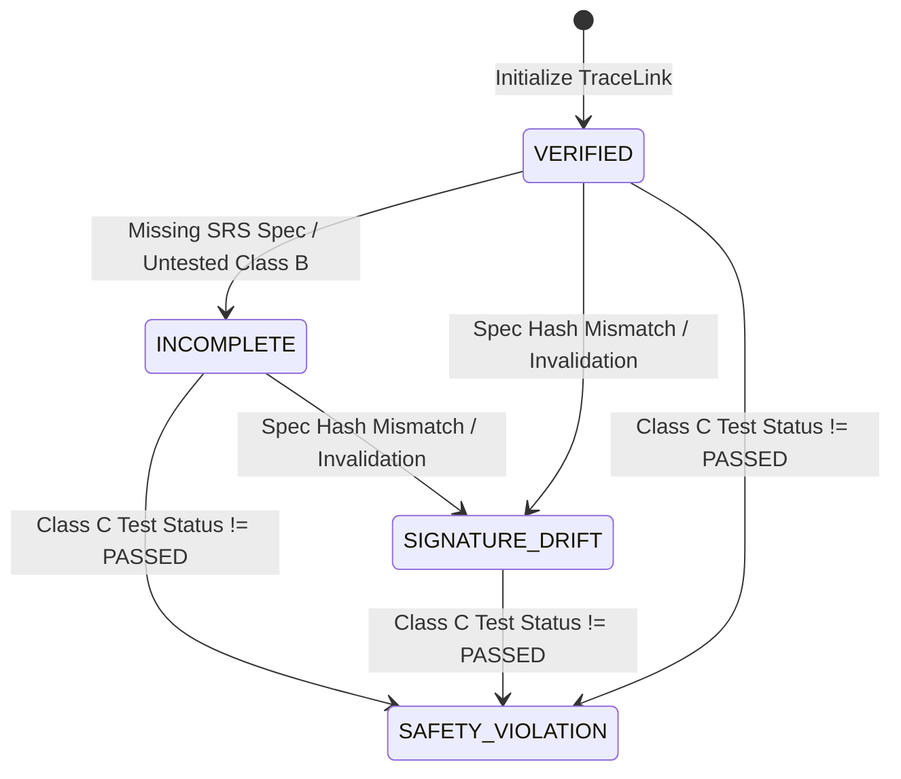

**Back:** [00-overview](./00-overview.md)

# Regulatory Compliance Evaluation Rules

The compliance evaluation logic is implemented as pure, synchronous domain functions in `src/compliance-engine.ts` operating over the `TraceLink` data model declared in `src/types.ts`.

---

## Evaluation Engine Public API (`src/compliance-engine.ts`)

### 1. `ComplianceEngine.evaluateTraceLink`
Evaluates a single 5-stage trace link and computes its `complianceState` and active violation messages:
```typescript
public static evaluateTraceLink(
  hazard: IsoHazard,
  spec: ConfluenceSpec,
  work: JiraWorkItem,
  test: VerificationTest,
  signature: Part11Signature,
  graphMetadata?: GraphMetadata
): TraceLink
```
* **Output ID Convention:** Constructs `id` as `trace-${hazard.key}` (e.g. `trace-HAZ-101`).
* **GraphMetadata Pass-Through:** The optional `GraphMetadata` parameter (`entityAri`, `linkedSpecAri`, `edgeType`, `aggTraversalStatus`) is strictly pass-through metadata attached to the returned `TraceLink` for Custom UI rendering and Teamwork Graph drawer inspection. It does not alter compliance state transitions.

### 2. `ComplianceEngine.generateComplianceReport`
Aggregates an array of evaluated `TraceLink` objects into a project-wide compliance summary:
```typescript
public static generateComplianceReport(traceLinks: TraceLink[]): ComplianceSummary
```
* **Pure Synchronous Execution:** Does **not** perform I/O or persist data directly. Persistence to `@forge/kvs` is handled by caller services (`SeederService` and Forge resolvers in `src/index.ts`).
* **Release Blocking Calculation:**
  ```typescript
  const releaseBlocked = blockingReasons.length > 0;
  ```
  Any non-verified state (`SAFETY_VIOLATION`, `SIGNATURE_DRIFT`, or `INCOMPLETE`) across any risk class contributes to `blockingReasons` and locks release readiness.
* **Verified Metric:** Computes `verifiedPercentage = traceLinks.length > 0 ? Math.round((verifiedCount / traceLinks.length) * 100) : 0`.
* **Dataset Mode:** The summary always carries `datasetMode: 'DEMO' | 'LIVE'`. Seeded suites are `'DEMO'` (`'LIVE'` is reserved for a future tenant-evidence mode); the Custom UI renders a persistent badge so modeled records are never mistaken for tenant evidence.

### 3. `ComplianceEngine.computeBlastRadius`
Executes a deterministic breadth-first traversal over the artifact-node graph derived from the typed 5-stage traceability graph (`HAZARD`, `SPEC`, `WORK`, `TEST`, `SIGNATURE`) to calculate transitive downstream impact when specifications drift or tests fail:
```typescript
public static computeBlastRadius(triggerKey: string, suite: ComplianceSummary): BlastRadiusReport
```
* **Artifact-Node Adjacency:** Builds a `nodeKey -> containing links` index (`spec:`, `haz:`, `work:`, `test:`, `sig:` keys) so the FIFO frontier crosses from one trace link into sibling links that share a hazard, spec, work item, test, or signature node. Traversal is therefore genuinely transitive, not limited to a single link's fixed chain.
* **Deterministic Cycle Protection:** Maintains visited sets over typed graph nodes and relation keys (`mitigates:${specId}->${hazKey}`), preventing infinite loops on circular trace links.
* **4-Hop Traversal Cascade:**
  1. `SIGNS` (Spec $\rightarrow$ Signature): Identifies invalidated electronic signatures.
  2. `MITIGATES` (Spec $\rightarrow$ Hazard): Flags compromised ISO 14971 hazards.
  3. `IMPLEMENTS` (Hazard $\rightarrow$ Jira Work Item): Locks downstream firmware development tasks under human-transition policy gate.
  4. `VERIFIES` (Hazard $\rightarrow$ Verification Test): Flags invalidated verification test evidence.
* **Test-Enforced Performance Ceiling:** The automated suite asserts the 500-node synthetic benchmark (100 five-stage links) completes in under 20ms, with an internal wall-clock execution timer recorded in `executionTimeMs`. Single-digit milliseconds are typical on the seeded suite.

---

## Regulatory Standards & Evaluation Matrix

The engine evaluates each trace link against three international regulatory frameworks:

| Standard / Clause | Trigger Condition | Assigned State | Violation Prefix & Behavior |
|---|---|---|---|
| **ISO 14971:2019**<br/>Risk Management | `!spec.title \|\| spec.title.trim() === ''` | `INCOMPLETE` | `ISO 14971 Violation:` Hazard lacks linked Software Safety Specification. |
| **IEC 62304:2006+A1**<br/>Clause 5.7/5.8 (Class C) | `hazard.riskClass === 'CLASS_C'` and `test.status !== 'PASSED'` | `SAFETY_VIOLATION` | `IEC 62304 Critical Gap:` Class C Hazard requires verified test coverage. Blocks release. |
| **IEC 62304:2006+A1**<br/>Clause 5.7/5.8 (Class B) | `hazard.riskClass === 'CLASS_B'` and `test.status !== 'PASSED'` | `INCOMPLETE` | `IEC 62304 Notice:` Class B Hazard verification test is not passed. |
| **IEC 62304:2006+A1**<br/>Clause 5.7/5.8 (Class A) | `hazard.riskClass === 'CLASS_A'` | `VERIFIED` | Pass-through validation (no safety violations). |
| **FDA 21 CFR Part 11**<br/>Electronic Signatures | `spec.sha256Hash !== signature.artifactSha256` or `spec.isSignatureInvalidated === true` | `SIGNATURE_DRIFT` | `Cryptographic Signature Drift:` Confluence Spec was modified after clinical sign-off. |

---

## State Transition & Precedence Model

The compliance engine models state using a strict 4-state enum:
```typescript
type ComplianceState = 'VERIFIED' | 'SAFETY_VIOLATION' | 'SIGNATURE_DRIFT' | 'INCOMPLETE';
```

1. **Default Initialization:** Each trace link begins in the `'VERIFIED'` state.
2. **Safety Override (`SAFETY_VIOLATION`):** For `CLASS_C` hazards with non-passed tests, `SAFETY_VIOLATION` is terminal and cannot be overridden by `SIGNATURE_DRIFT` or `INCOMPLETE`. Patient safety risk takes legal precedence over electronic record drift.
3. **Drift Override (`SIGNATURE_DRIFT`):** If signature drift occurs on a link that has an `INCOMPLETE` status, `SIGNATURE_DRIFT` takes precedence unless a `SAFETY_VIOLATION` is active.



---

## Integration with Jira Workflow Release Gate

While `ComplianceEngine` calculates compliance state in memory, physical enforcement occurs at the Jira issue transition boundary:
1. `ComplianceSummary` is cached in `@forge/kvs` under `medtrace:compliance:active_suite`.
2. When a user transitions a Jira issue to "Done", `jira:workflowValidator` invokes `workflowValidatorHandler` (`src/workflow-validator.ts`).
3. **Scoped Transition Validation:** The validator extracts the issue key (`payload.issue.key`). If linked to a safety hazard with open violations, the transition is halted by the human-transition policy gate. Unrelated everyday Jira issues are permitted to transition. (CI/CD pipelines enforce identical policy via signed webtriggers to pre-empt platform issue ECO-624).
4. **Fail-Closed Safety Invariant:** If storage retrieval fails or an unhandled exception occurs, the validator rejects the transition with:
   > *"MedTrace Safety Gate: Unable to verify IEC 62304 compliance integrity. Transition halted."*

---

## Seeder & Persistence Service (`src/seeder.ts`)

The `SeederService` manages persistence and life-cycle data orchestration:

| Method | Return Signature | Description |
|---|---|---|
| `seedEnterpriseDemoSuite` | `Promise<{ success, summary, message }>` | Generates demo hazards, Confluence SRS pages, Jira work items, and Part 11 signatures, evaluating them with `ComplianceEngine` and persisting to KVS. |
| `getActiveComplianceSuite` | `Promise<ComplianceSummary>` | Retrieves cached suite from KVS. If uninitialized, lazily executes `seedEnterpriseDemoSuite` to guarantee zero blank-screen states. |
| `remediateClassCGap` | `Promise<ComplianceSummary>` | Simulates 120/120 automated HIL test assertions passing for `HAZ-101`, re-hashes the Confluence spec, re-certifies the Part 11 signature, and saves the verified state. |

---

## Automated Verification Suite

All engine rules and precedence edge cases are verified by `tests/compliance-engine.test.cjs`:
* `evaluates fully compliant Class C hazard as VERIFIED`
* `blocks Class C hazard when verification test is UNTESTED`
* `flags Class B hazard as INCOMPLETE when test status is FAILED`
* `flags signature-fingerprint drift when Confluence hash diverges`
* `ensures SAFETY_VIOLATION takes precedence over SIGNATURE_DRIFT on Class C hazards`
* `generates compliance report and blocks release if any violations exist`
* `blocks issue transition when linked to an unverified safety hazard`
* `approves issue transition when issue has no safety violations`
* `approves transition for unrelated everyday Jira issues not linked to hazards`
* `traverses 4-hop cascade deterministically when specification drifts`
* `terminates deterministically and prevents infinite loops on circular trace links`
* `invalidates multiple electronic signatures on one artifact when specification drifts`
* `traverses both specifications when two specs are connected to one hazard`
* `excludes disconnected nodes (HAZ-999) from the blast radius`
* `completes BFS traversal on 500-node synthetic graph benchmark in under 20ms`
* `rejects duplicate in-window nonce replay with HTTP 409 Conflict`

---

## Key Files

| Path | Role |
|---|---|
| `src/compliance-engine.ts` | Pure domain calculation engine implementing evaluation rules and summary reporting. |
| `src/types.ts` | Data models for `TraceLink`, `IsoHazard`, `ConfluenceSpec`, `VerificationTest`, and `Part11Signature`. |
| `src/seeder.ts` | Data provisioning and `@forge/kvs` persistence service (`medtrace:compliance:active_suite`). |
| `tests/compliance-engine.test.cjs` | Automated Node.js test suite exercising compliance evaluation logic. |

---

## Related

- [Architecture & Forge Modules](../01-architecture/forge-modules.md)
- [Live MCP Sync Architecture](../03-mcp-integration/live-sync.md)
- [How-To: Add an ISO 14971 Clinical Hazard](../00-how-to/01-add-iso-hazard.md)
