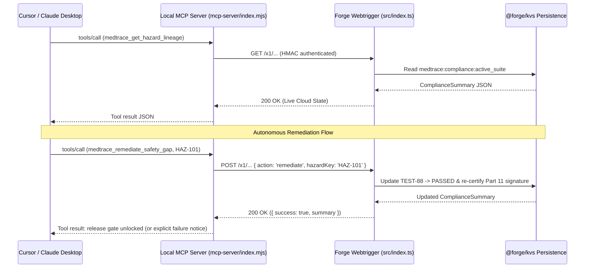

**Back:** [00-overview](./00-overview.md)

# Live MCP Sync & Stdio Server

MedTrace provides dual Model Context Protocol support:
1. **Cloud-Native `rovo:mcp`:** Declared in `manifest.yml` and routed through `rovo-action-fn` (`src/mcp-server.ts`) for Atlassian Rovo conversational agents.
2. **Local Stdio JSON-RPC Server:** Standalone, zero-dependency Node.js script in `mcp-server/index.mjs` for local IDE coding environments (Cursor, Claude Desktop).

---

## Tool Registry Specifications

### 1. Local Stdio Tools (`mcp-server/index.mjs`)

| Tool Identifier | Input Schema | Return Payload (stdio server) | Purpose |
|---|---|---|---|
| `medtrace_get_hazard_lineage` | `{ hazardKey?: string }` | `{ source, hazard, spec, work, test, signature, complianceState, violations }` for a match, or `{ source, projectName, totalHazards, verifiedPercentage, releaseBlocked, traceLinks }` for the full suite; `source: 'UNAVAILABLE'` when the cloud is unreachable | Returns the 5-stage trace lineage for a specific hazard or the full project suite, live from Forge KVS. |
| `medtrace_verify_iec_compliance` | `{ prDiff?: string, componentName?: string, issueKey?: string }` | `{ source, releaseGateStatus, verifiedCoverage, touchesSafetyCriticalCode, affectedHazards, safetyWarning, activeViolations }` — `source: 'UNAVAILABLE'` when the cloud is unreachable | Keyword-matches a diff against safety-critical hazards against live cloud state; full blast-radius traversal runs on the Forge backend. |
| `medtrace_remediate_safety_gap` | `{ hazardKey: string }` | Text confirming the cloud applied the remediation, or an explicit failure notice when no confirmation was received — never a fabricated success | Marks the verification test PASSED and re-certifies the Part 11 signature live on Atlassian Cloud. |

### 2. Atlassian Rovo Action Modules (`manifest.yml` / `src/mcp-server.ts`)

| Action Key | Action Verb | Handler Method | Inputs |
|---|---|---|---|
| `get-hazard-lineage-action` | `GET` | `McpToolService.getHazardLineage` | `{ issueKey?: string }` |
| `verify-iec-compliance-action` | `GET` | `McpToolService.verifyIecCompliance` | `{ issueKey?: string, prDiff?: string, componentName?: string }` |

---

## 2-Way Cloud Synchronization Architecture

`mcp-server/index.mjs` communicates with Atlassian Cloud via an authenticated HTTPS webtrigger (`mcp-sync-webtrigger` in `src/index.ts`):



* **Configuration Parameters:**
  * **Webtrigger URL:** Set via environment variable `MEDTRACE_WEBTRIGGER_URL` (points to your deployed Forge `mcp-sync-webtrigger`).
  * **Shared Secret:** Set via environment variable `MEDTRACE_MCP_SECRET`. Mandatory in production; the webtrigger and MCP server fail closed if unset.
* **Offline Behavior (no fabricated state):** If the cloud webtrigger is unreachable (network drop or 4-second timeout), no mock suite is used: lineage and compliance checks return `source: 'UNAVAILABLE'`, and remediation reports an explicit failure. The server never invents compliance state.

---

## Cryptographic Security & Anti-Replay Defense

The webtrigger endpoint in `src/index.ts` verifies incoming requests using `verifyHmacSignature()`:
1. **HMAC-SHA256 Payload Signature:** All requests (`GET` and `POST`) must provide `x-medtrace-timestamp`, `x-medtrace-nonce` (required), and `x-medtrace-signature: sha256=<hex>` over `${timestamp}.${nonce}.${rawBody}` using the shared secret.
2. **Anti-Replay Window (300 Seconds):** The server verifies `x-medtrace-timestamp`. If `Math.abs(Date.now() - reqTime) > 300_000`, the request is rejected with HTTP 401.
3. **Timing-Safe Digest Comparison:** Verifies signatures using `crypto.timingSafeEqual` over pre-computed digest buffers, preventing timing side-channel attacks.
4. **In-Window Nonce Replay Defense (`x-medtrace-nonce`):** Rejects replayed requests within the 300-second window using persistent Forge app storage (`storage:app`), halting duplicate invocations with HTTP 409 Conflict across ephemeral serverless containers.
5. **Header-Only Authentication:** Rejects credentials passed via URL query parameters (`query.token`) to prevent secrets from leaking into server logs, proxies, and browser histories.

Automated verification tests are maintained in `tests/compliance-engine.test.cjs`.

---

## IDE Setup (Cursor Configuration)

```json
{
  "mcpServers": {
    "medtrace": {
      "command": "node",
      "args": ["/absolute/path/to/medtrace/mcp-server/index.mjs"],
      "env": {
        "MEDTRACE_MCP_SECRET": "<your-forge-mcp-secret>",
        "MEDTRACE_WEBTRIGGER_URL": "https://<forge-app-id>.hello.atlassian-dev.net/x1/..."
      }
    }
  }
}
```

---

## Key Files

| Path | Role |
|---|---|
| `mcp-server/index.mjs` | Local stdio JSON-RPC MCP server with live cloud sync and honest unavailability reporting. |
| `src/mcp-server.ts` | Handlers for manifest-declared `rovo:mcp` tools and Rovo chat actions. |
| `src/nonce-store.ts` | NonceStore interface and `@forge/kvs` persistent store with lazy pruning. |
| `src/index.ts` | Webtrigger handler verifying HMAC signatures and executing mutations. |
| `tests/compliance-engine.test.cjs` | Unit tests for HMAC generation, timing safety, and replay window expiration. |

---

## Related

- [Forge Modules & Manifest Extensions](../01-architecture/forge-modules.md)
- [Compliance Evaluation Rules](../02-compliance-engine/evaluation-rules.md)
- [ADR 002: Webtrigger HMAC Authentication](../99-design-decisions/002-webtrigger-hmac-authentication.md)
- [How-To: Add an MCP Tool](../00-how-to/02-add-mcp-tool.md)
